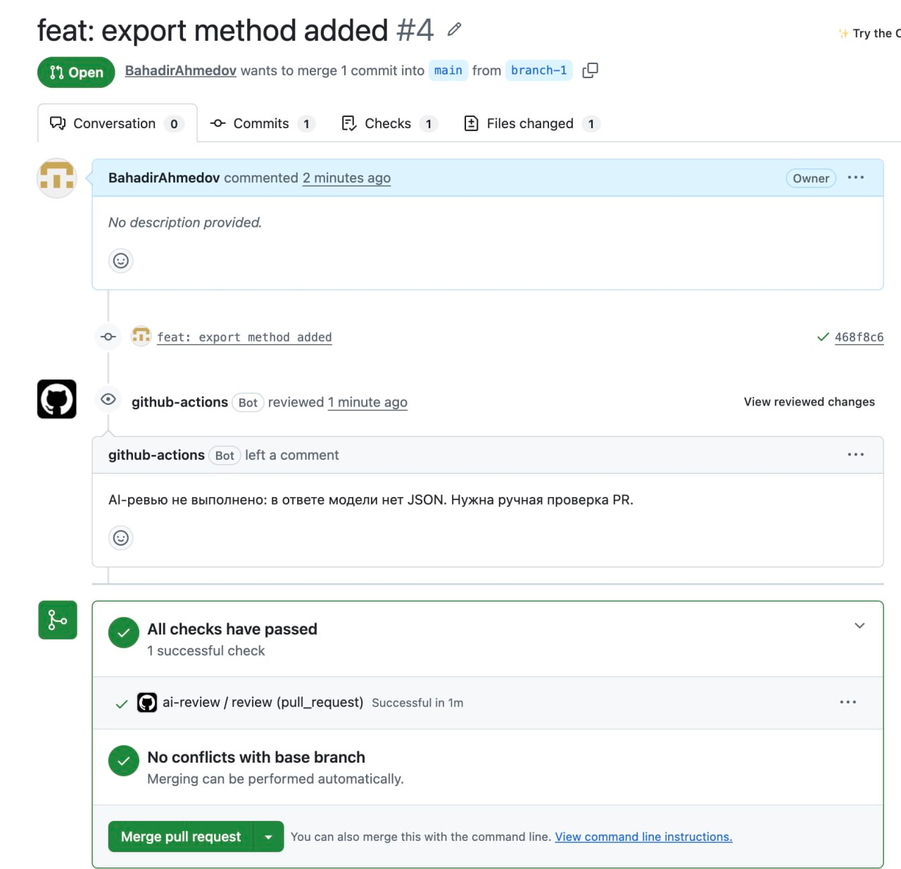
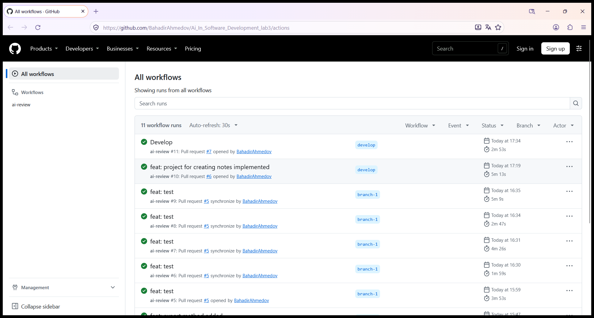
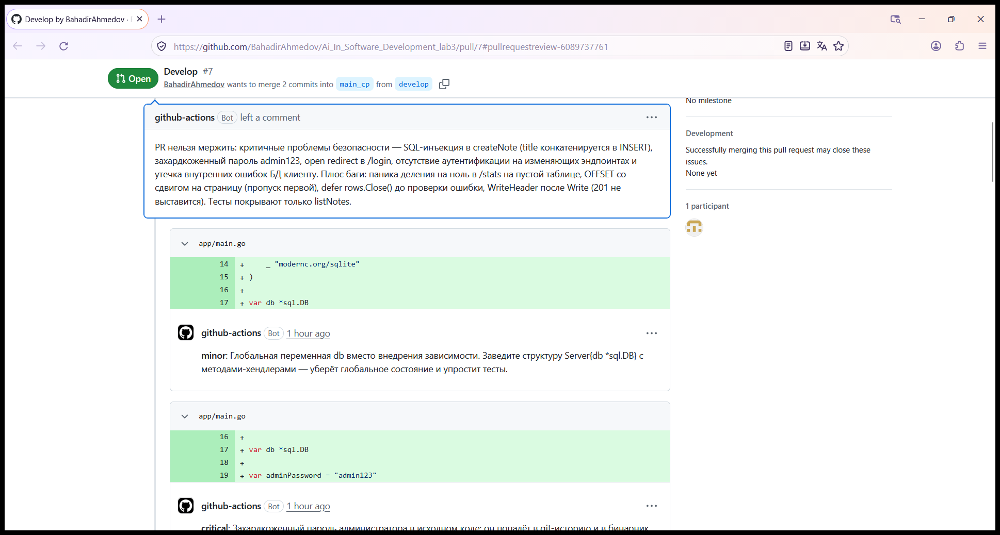
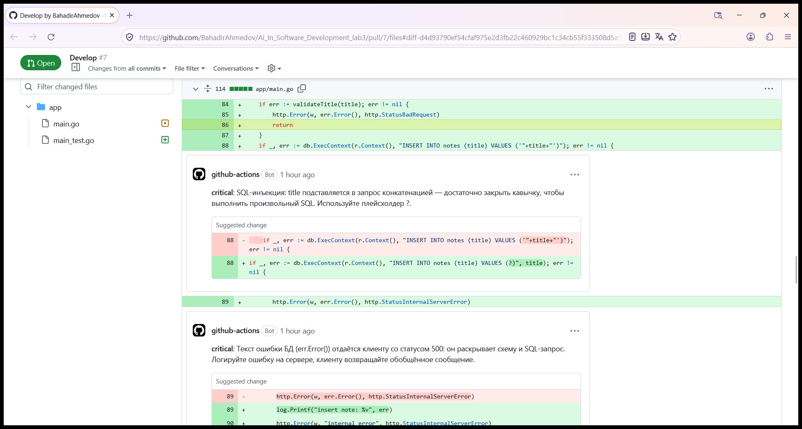
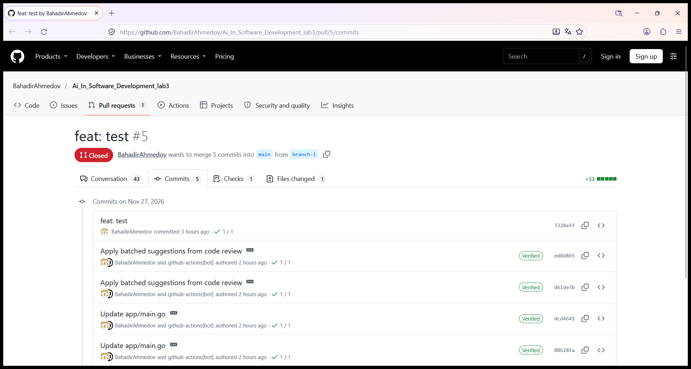

# Отчёт по лабораторной работе «AI code-review бот в CI»

| | |
|---|---|
| Репозиторий | https://github.com/BahadirAhmedov/Ai_In_Software_Development_lab3 |
| Модель | GLM-5.3 через API Z.ai |
| Тестовый PR | [#7](https://github.com/BahadirAhmedov/Ai_In_Software_Development_lab3/pull/7), `develop` в `main_cp` |
| Файлы бота | `.github/workflows/ai-review.yml`, `review.js`, `.github/review-instructions.md` |

## 1. Как устроен бот

| Требование | Как сделано |
|---|---|
| Триггер | `pull_request`, типы `opened` и `synchronize` |
| Diff всего PR | `git diff origin/<base>...<head.sha>` (three-dot), checkout с `fetch-depth: 0` |
| Исключения из diff | `*.lock`, `**/go.sum`, `**/dist/**`, `**/generated/**`, `*.pb.go`, `*_gen.go`; у бинарных файлов `git diff` содержимое не выводит |
| Порог размера | больше 500 изменённых строк или 20 файлов, тогда модель не вызывается и публикуется «PR слишком большой для автоматического ревью (...), review пропущен» |
| Инструкции | `review-instructions.md` целиком уходит модели как системное сообщение |
| Номера строк | `review.js` нумерует строки diff по заголовкам hunk, модель видит diff с номерами |
| Structured output | JSON-режим (`response_format: json_object`), формат `{summary, comments: [{file, line, severity, message, suggestion}]}` |
| Проверка строк | комментарий с файлом или строкой вне diff отбрасывается, иначе GitHub отклонил бы всё review с ошибкой 422 |
| Fallback | при ошибке API, сети, таймауте, пустом, обрезанном или невалидном ответе публикуется «AI-ревью не выполнено: <причина>», скрипт завершается с кодом 0 |
| Публикация | один вызов `pulls.createReview`, `event: COMMENT`, `commit_id` равен head PR, `side: RIGHT`, правки в блоке `suggestion` |
| Секреты и права | ключ в секрете `GLM_API_KEY`, в коде и логах его нет; права job только `contents: read` и `pull-requests: write` |

Порог 500 строк выбран потому, что для нашего сервиса из одного файла такой PR означает почти полное переписывание, и смотреть его должен человек. Кроме того, PR #7 в 142 строки модель разбирала 159 с и потратила 15 791 токен ответа при лимите 32 000, так что diff в несколько раз больше может упереться в лимит ответа и в 300-секундный таймаут `fetch`.

## 2. Надёжность

Все запуски workflow, начиная с #3, зелёные (рисунок 2). На настоящих PR fallback сработал в четырёх запусках.

| PR, запуск | Что случилось | Что опубликовал бот |
|---|---|---|
| #4, запуск #4 | модель вернула ответ без JSON | «AI-ревью не выполнено: в ответе модели нет JSON» (рисунок 1) |
| #5, запуск #6 | API вернул ошибку 500 | «AI-ревью не выполнено: API модели вернул ошибку 500» |
| #5, запуск #9; #6, запуск #10 | ответ не пришёл за 300 с | «AI-ревью не выполнено: ошибка при обращении к модели (fetch failed)» |

После запуска #4 лимит ответа подняли с 8 192 до 32 000 токенов и включили JSON-режим. Невалидный JSON, ответ без массива `comments`, обрезанный ответ, строку вне diff и PR больше порога мы проверили локально, подменив `fetch` заглушкой.

Рисунок 1. Модель вернула ответ без JSON, бот опубликовал сообщение, проверка при этом зелёная (PR #4)

Рисунок 2. Запуски workflow `ai-review` на вкладке Actions

## 3. Тестовый PR и результат ревью

В PR #7 (`app/main.go`, 114 строк, и `app/main_test.go`) мы заложили 19 проблем четырёх категорий и 3 ловушки на ложное срабатывание. Бот оставил review с итогом и 19 комментариями к строкам, у 15 из них есть suggestion.

Рисунок 3. Итог ревью на вкладке Conversation (PR #7)

Рисунок 4. Комментарии к строкам 88 и 89 с предложенными правками (PR #7)

### Сопоставление с эталоном

| ID | Строка | Заложенная проблема | Найдено | Severity: эталон / бот |
|---|---|---|---|---|
| S1 | 19 | захардкоженный пароль `admin123` | да | critical / critical |
| S2 | 88 | SQL-инъекция в `INSERT` | да | critical / critical |
| S3 | 89 | `err.Error()` уходит клиенту | да | critical / critical |
| S4 | 107 | пароль сравнивается через `!=`, без constant-time | нет | |
| S5 | 111 | токен сессии из `math/rand/v2` | да | critical / major |
| S6 | 113 | open redirect через `?next=` | да | critical / critical |
| B1 | 50 | off-by-one в пагинации, `page*20` | да | major / major |
| B2 | 51 | `defer rows.Close()` до проверки `err` | да | major / major |
| B3 | 74 | результат `TrimSpace` отброшен | да | major / major |
| B4 | 92-93 | `WriteHeader(201)` после `Write` | да | major / major |
| B5 | 103 | деление на ноль на пустой таблице | да | major / major |
| T1 | 73 | нет теста `validateTitle` | нет | |
| T2 | 82 | нет теста `createNote` | да (1) | |
| T3 | 96 | нет теста `Get_Stats` | да (1) | |
| T4 | 106 | нет теста `login` | да (1) | |
| St1 | 96 | `Get_Stats`: snake_case и экспортируемое имя | да | minor / minor |
| St2 | 76 | ошибка с заглавной буквы и с точкой | частично (2) | minor / major |
| St3 | 77 | `else` после `return` | нет | |
| St4 | 49-50 | магическое число `20` | нет | |

(1) Все три функции перечислены в одном комментарии к `main_test.go:10`, как и требуют инструкции.

(2) Про заглавную букву сказано внутри major-комментария к B3, про точку ничего.

| Ловушка | На что похоже | Реакция бота |
|---|---|---|
| FP1, строка 49 | `fmt.Sprintf` в `ORDER BY` как SQL-инъекция | не тронул, в `%s` попадает только значение из белого списка `sortColumns` |
| FP2, строка 103 | `math/rand` для выбора подсказки | не тронул, хотя тот же пакет для токена в строке 111 отметил |
| FP3 | «нет тестов для `listNotes`» | прямо написал, что тест у `listNotes` есть |

## 4. Метрики

| Метрика | Значение | Как считали |
|---|---|---|
| Recall | 15 / 19 = 79 % | найдено заложенных / всего заложенных |
| Precision | 18 / 19 = 95 % | (комментарии на заложенные + на реальные незаложенные) / все комментарии |
| False positives | 1 (спорный) | комментарии без реальной проблемы |
| Hallucination rate | 0 / 3 = 0 % | сработавшие ловушки / все ловушки |
| Severity accuracy | 10 / 12 = 83 % | находки с верным severity / находки, у которых в эталоне есть severity |

| Категория | Найдено | Recall |
|---|---|---|
| Security | 5 / 6 | 83 % |
| Bug | 5 / 5 | 100 % |
| Missing test | 3 / 4 | 75 % |
| Style | 2 / 4 | 50 % |

Если St2 не засчитывать, recall равен 14 / 19 = 74 %.

Из 19 комментариев 12 попали в заложенные проблемы (строки 19, 50, 51, 74, 88, 89, 92, 96, 103, 111, 113 и `main_test.go:10`). Ещё 6 указывают на реальные проблемы, которые мы не закладывали: глобальная `db` (17), нет `db.Ping()` и `db.Close()` (27), `DefaultServeMux` и захардкоженные `:8080` и `data.db` (33), `ListenAndServe` без таймаутов (37), данные из `FormValue` вместо JSON и без `MaxBytesReader` (83), изменяющие эндпоинты не проверяют сессию (106). Спорным мы считаем комментарий к строке 30 про миграцию при старте. Дефекта в коде там нет, это архитектурное пожелание, хотя раздел 5 инструкций его допускает. Если его засчитать, precision будет 100 %.

## 5. Анализ качества ревьюера

Бот хорошо находит баги и очевидные уязвимости. Все пять багов найдены и привязаны к нужным строкам, выдуманных проблем нет, ни одна ловушка не сработала. Особенно показательна FP2, где один и тот же пакет `math/rand` бот считает уязвимостью только там, где из него делают токен.

Пропущены timing-атака при сравнении пароля (S4), которой нет в инструкциях явно, тест на `validateTitle` (T1) и мелкий стиль (St3, St4). Уязвимость S5 бот оценил как `major`, хотя по нашим инструкциям она `critical`, а заниженную оценку автору PR проще проигнорировать.

Правки бота требуют проверки человеком. Кнопка Commit suggestion работает, ей применялись правки в PR #5 (рисунок 5), но если применять правки PR #7 по одной, 8 из 15 ломают сборку. В них многострочный блок привязан к одной строке, не хватает импорта или правка опирается на другую правку.

Рисунок 5. Коммиты, созданные кнопкой Commit suggestion, соавтор `github-actions[bot]` (PR #5)

В целом бот подходит как первый ревьюер, потому что находит 4 из 5 заложенных проблем и почти не шумит. Доработать стоит четыре вещи.

1. Добавить в инструкции сравнение секретов через `subtle.ConstantTimeCompare`, магические числа и `else` после `return`.
2. Прямо указать, что небезопасная генерация токенов, паролей и ключей имеет уровень `critical`.
3. Писать стилевые замечания отдельными комментариями, не внутри комментариев о багах.
4. Добавить в формат ответа `start_line`, чтобы многострочные правки заменяли нужный диапазон.

Оценка сделана по одному прогону на 19 проблемах и 3 ловушках. Повторный запуск LLM может дать на 1-2 находки больше или меньше, а одна находка меняет recall примерно на 5 процентных пунктов.
